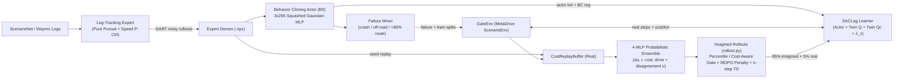

# GATE-SAC: Uncertainty-Gated Reinforcement Fine-Tuning for Safety-Critical Autonomous Driving

**GATE-SAC** (*Gated Adaptive Truncation and Ensemble Soft Actor-Critic*) is a model-based, safety-constrained reinforcement learning pipeline for fine-tuning imitation-learned autonomous driving policies on safety-critical failure scenarios in **MetaDrive / ScenarioNet**.

See [`GATE-SAC-project-proposal.pdf`](GATE-SAC-project-proposal.pdf) for the original proposal, [`docs/GATE-SAC-literature-survey.md`](docs/GATE-SAC-literature-survey.md) for the related-work survey, and [`docs/GATE-SAC-foundations.md`](docs/GATE-SAC-foundations.md) for background concepts.

---

## Architecture Overview



### Key Design Choices
1. **Action Labels Without Inverse Dynamics (`gate_sac/envs/expert.py`):** Real driving logs (Waymo / nuScenes) contain poses and velocities rather than `[steer, throttle]` commands. `LogTrackingExpert` closes the loop inside MetaDrive using pure-pursuit steering on the nearest lookahead waypoint plus proportional speed control, producing physics-consistent `(obs, expert_action)` pairs with optional DART-style Gaussian execution noise for recovery coverage.
2. **Reward–Cost Separation (`gate_sac/envs/scenario_env.py`):** Task reward is strictly progress-focused (`r = progress + speed - lane_deviation + success_bonus`, with **zero** terminal crash penalty). Collisions and road departures enter exclusively through the binary cost signal `c ∈ {0, 1}`, twin pessimistic cost critics `max(Qc1, Qc2)`, and Lagrange multiplier `λ_c` updated via dual ascent on **real** windowed `(collisions + out_of_road) / km`.
3. **Preventing Actor Unlearning (`gate_sac/agents/sac_lag.py`):** Because Behavior Cloning trains an identical SB3 `SACPolicy` actor (`[256, 256, 256]`), its weights load directly into `SACLag`. To prevent randomly initialized critics from overwriting BC skills, the actor and entropy temperature are frozen for `warmup_updates` gradient steps while critics warm up on demo-seeded replay data, followed by a linearly annealed BC regularizer `β · ||π(s) - π_BC(s)||²`.
4. **Scale-Free Gating, MOPO Pessimism & n-Step Targets (`gate_sac/agents/rollout.py`):** One-step ensemble disagreement `u(s, a)` on real start states sets an EMA reference median and `gate_percentile` threshold (`u_norm = u / median_ref`). Imagined rollouts truncate dynamically when `u_norm > threshold` (with an optional `cost_aware_gate` mode that retains high-uncertainty transitions as terminal `cost = 1` events if `cost_prob >= 0.5`), penalize surviving rewards by `r - penalty · u_norm`, and compute Dreamer-SAC *n*-step targets over the surviving rollout length.

---

## Environment Setup

### Option A: Existing Conda Environment (TAMU Server / Lab Machine)
If the `ssl` conda environment is already provisioned:
```bash
conda activate ssl
```

### Option B: Fresh Setup (Local macOS/Linux or TAMU HPRC)
> **Note:** `metadrive-simulator==0.4.3` requires **Python 3.10 or 3.11** (Python 3.12+ is unsupported by MetaDrive 0.4.x).

```bash
conda create -n ssl python=3.10 -y
conda activate ssl

pip install metadrive-simulator==0.4.3 stable-baselines3==2.9.0 gymnasium torch numpy scipy scikit-learn pyyaml tensorboard tqdm
pip install git+https://github.com/metadriverse/scenarionet.git

# Pull MetaDrive assets (includes 3 Waymo and 10 nuScenes sample scenarios)
python -m metadrive.pull_asset
```

---

## Repository Layout

| Path | Description |
|---|---|
| [`gate_sac/envs/scenario_env.py`](gate_sac/envs/scenario_env.py) | `GateScenarioEnv` (decoupled progress/lane reward & crash termination) and `GateEnv` wrapper (split sampling + per-km episode safety metrics). |
| [`gate_sac/envs/expert.py`](gate_sac/envs/expert.py) | `LogTrackingExpert`: pure-pursuit lateral + proportional speed controller tracking logged human trajectories. |
| [`gate_sac/data/splits.py`](gate_sac/data/splits.py) | Builds deterministic `train` / `test` / `failure` JSON splits, filtering out stationary ego scenarios (`moving_distance < 20m`). |
| [`gate_sac/bc/collect.py`](gate_sac/bc/collect.py) | Collects clean + DART-noisy expert rollouts (`obs`, `expert_action`, `action`, `reward`, `cost`, `next_obs`, `terminated`, `truncated`). |
| [`gate_sac/bc/train_bc.py`](gate_sac/bc/train_bc.py) | Trains the **B0** Behavior Cloning policy (an SB3 squashed-Gaussian SAC actor, `3×256` MLP) using NLL + mean-action MSE. |
| [`gate_sac/bc/mine_failures.py`](gate_sac/bc/mine_failures.py) | Evaluates the BC actor across `train` scenarios and populates `splits["failure"]` (crash, off-road, or `< 80%` route completion). |
| [`gate_sac/models/ensemble.py`](gate_sac/models/ensemble.py) | Vectorized 4-member probabilistic MLP ensemble (`4×256` SiLU) with bootstrap resampling, Gaussian NLL (`Δs, r`), weighted BCE (`cost, done`), holdout early stopping, and epistemic disagreement `u`. |
| [`gate_sac/agents/rollout.py`](gate_sac/agents/rollout.py) | Branched ensemble imagination: `UncertaintyReference` EMA calibration, percentile & cost-aware gating, MOPO reward penalty, and *n*-step target backups. |
| [`gate_sac/agents/sac_lag.py`](gate_sac/agents/sac_lag.py) | `SACLag` (subclasses SB3 `SAC`) + `CostReplayBuffer`: twin pessimistic cost critics, `λ_c` dual ascent on real cost/km, critic warm-up, annealed BC loss, and real/imagined batch mixing. |
| [`gate_sac/train.py`](gate_sac/train.py) | CLI entry point for training one method config × random seed, saving periodic checkpoints and `progress.csv` / TensorBoard logs. |
| [`gate_sac/eval/evaluate.py`](gate_sac/eval/evaluate.py) | Closed-loop deterministic evaluation for `--expert`, `--bc`, or `--model` checkpoints on any split (`test`, `train`, `failure`). |
| [`configs/`](configs/) | Hierarchical YAML configs defining `base.yaml`, `model_base.yaml`, and all experiment matrix methods. |
| [`scripts/hprc/sweep.slurm`](scripts/hprc/sweep.slurm) | SLURM job-array script (`9 configs × 5 seeds = 45` GPU jobs) for TAMU HPRC. |
| [`docs/`](docs/) | Project documentation: foundations guide, implementation plan, literature survey, and BibTeX references. |

---

## Experiment Matrix (`configs/`)

| ID | Config / Artifact | World Model | Horizon $H$ | Gate | MOPO Penalty | Lagrangian (`λ_c`) | Purpose |
|---|---|---|---|---|---|---|---|
| **B0** | `runs/bc/actor.pt` | – | – | – | – | – | Imitation Learning floor (Behavior Cloning only) |
| **B1** | [`configs/b1_sac.yaml`](configs/b1_sac.yaml) | – | – | – | – | – | Model-free SAC fine-tuning floor (UTD = 1) |
| **B2** | [`configs/b2_saclag.yaml`](configs/b2_saclag.yaml) | – | – | – | – | ✓ | Isolates the Constrained MDP safety layer (model-free) |
| **B3** | [`configs/b3_mbpo_h{1,3,5,7}.yaml`](configs/b3_mbpo_h5.yaml) | ✓ (4 MLPs) | Fixed `{1,3,5,7}` | – | – | ✓ | Fixed-horizon MBPO benchmark (sweep $H$, compare against best) |
| **A1** | [`configs/a1_penalty.yaml`](configs/a1_penalty.yaml) | ✓ (4 MLPs) | Fixed `5` | – | `0.5` | ✓ | Ablation: MOPO uncertainty penalty without truncation |
| **A2** | [`configs/a2_gate.yaml`](configs/a2_gate.yaml) | ✓ (4 MLPs) | Adaptive (`≤ 5`) | 80th pct | `0.0` | ✓ | Ablation: Running-percentile gate without reward penalty |
| **G** | [`configs/g_gatesac.yaml`](configs/g_gatesac.yaml) | ✓ (4 MLPs) | Adaptive (`≤ 5`) | 80th pct | `0.5` | ✓ | **Proposed GATE-SAC** (gate + MOPO penalty + Lagrangian SAC) |

> **Cost-Aware Gate Ablation:** `gate_sac/agents/rollout.py` also supports `cost_aware_gate: true` (retaining uncertain transitions with predicted crash probability `≥ 0.5` as terminal `cost = 1` transitions instead of dropping them). Add an `a3` / `g_cost_aware` YAML override to compare cost-unaware vs. cost-aware truncation.

---

## End-to-End Pipeline

### 1. Create Scenario Splits
Use `nuscenes` (10 bundled scenarios) or `waymo` (3 bundled scenarios) ONLY for quick local smoke tests; point `--data` to a converted ScenarioNet Waymo directory for actual experiments:
```bash
DATA=nuscenes                     # or ~/data/waymo_sn for real experiments
S=splits/dev.json

python -m gate_sac.data.splits --data $DATA --out $S --test-frac 0.25 --min-ego-distance 20.0
```

### 2. Verify Expert & Collect Demonstrations
```bash
# Optional: check clean log-tracking expert performance first
python -m gate_sac.eval.evaluate --splits $S --split train --expert

# Collect 1 clean pass + (N-1) DART-noisy passes per training scenario
python -m gate_sac.bc.collect --splits $S --split train \
    --episodes-per-scenario 10 --noise-std 0.1 --out runs/demos.npz
```

### 3. Train Behavior Cloning Policy (Baseline B0) & Evaluate
```bash
python -m gate_sac.bc.train_bc --demos runs/demos.npz --epochs 50 --seed 0 --out runs/bc/actor.pt

mkdir -p runs/eval
python -m gate_sac.eval.evaluate --splits $S --split test --bc runs/bc/actor.pt --out runs/eval/b0_test.json
```

### 4. Mine BC Failure Scenarios
Runs the BC policy across `splits["train"]` and records scenarios with crashes, road departures, or `< 80%` route completion into `splits["failure"]` (sampled with probability `failure_frac: 0.7` during RL):
```bash
python -m gate_sac.bc.mine_failures --splits $S --bc runs/bc/actor.pt --min-route-completion 0.8
```

### 5. Train RL / GATE-SAC
```bash
python -m gate_sac.train \
    --config configs/g_gatesac.yaml \
    --splits $S \
    --demos runs/demos.npz \
    --bc runs/bc/actor.pt \
    --seed 0 \
    --out runs/G_s0
```
*Tip:* Pass `--total-steps 2000` for a quick smoke test before launching 100k-step runs.

### 6. Evaluate Trained Checkpoints (Separate Process)
`CheckpointCallback` writes intermediate checkpoints named `model_<N>_steps.zip` plus `model_final.zip` at completion:
```bash
# Evaluate final model on held-out test scenarios and on training failure scenarios
python -m gate_sac.eval.evaluate --splits $S --split test \
    --model runs/G_s0/model_final.zip --out runs/eval/G_s0_test.json

python -m gate_sac.eval.evaluate --splits $S --split failure \
    --model runs/G_s0/model_final.zip --out runs/eval/G_s0_failure.json

# Evaluate an intermediate checkpoint (note the `_steps.zip` suffix from SB3)
python -m gate_sac.eval.evaluate --splits $S --split test \
    --model runs/G_s0/model_10000_steps.zip
```

---

## Importing Real Waymo Scenarios & Running on TAMU HPRC

### Converting Waymo Open Motion Dataset
1. Register for the [Waymo Open Dataset](https://waymo.com/open/) and download Motion dataset `scenario/*.tfrecord*` shards (e.g., 200–500 scenarios for tractable training/testing).
2. Create a **separate** conversion environment with TensorFlow and `waymo-open-dataset` (kept separate from `ssl` to avoid protobuf/CUDA conflicts):
   ```bash
   python -m scenarionet.convert_waymo \
       -d $SCRATCH/data/waymo_sn \
       --raw_data_path $SCRATCH/waymo_tfrecords \
       --num_workers 8
   ```
3. Generate splits and run Steps 2–4 once on the converted database to produce `splits/waymo.json`, `runs/demos.npz`, and `runs/bc/actor.pt`:
   ```bash
   python -m gate_sac.data.splits --data $SCRATCH/data/waymo_sn --out splits/waymo.json --test-frac 0.2
   ```

### Launching the HPRC SLURM Sweep
1. Ensure the `logs/` directory exists (`mkdir -p logs` — SLURM silently fails if the `--output` directory is missing).
2. Update `SPLITS`, `DEMOS`, `BC`, and `conda.sh` paths inside [`scripts/hprc/sweep.slurm`](scripts/hprc/sweep.slurm) to point to `$SCRATCH` (avoid filling `$HOME` quota with 45 × `.zip` checkpoints).
3. Submit the 45-job array (`9 configs × 5 seeds`):
   ```bash
   sbatch scripts/hprc/sweep.slurm
   ```

---

## Logged Metrics

Training writes both `progress.csv` and TensorBoard event files under `--out`:
- **Safety & Driving (`episode/*`):** `ret`, `cost`, `cost_per_km_window`, `success`, `crash`, `out_of_road`, `route_completion`, `avg_speed_kmh`
- **SAC-Lagrangian (`train/*`):** `critic_loss`, `cost_critic_loss`, `actor_loss`, `bc_loss`, `bc_beta`, `lambda_c`, `ent_coef`, `q`, `qc`, `n_updates`
- **World Model & Gate (`model/*`):** `holdout_mse`, `epochs`, `updates`, `transitions`, `mean_length`, `truncation_rate`, `u_norm_mean`, `threshold`, `imagined_cost`

---

## Important Conventions & Gotchas

- **Steering Sign Convention:** In MetaDrive, action dimension 0 is **`+1.0 = full left`** (counter-clockwise) and **`-1.0 = full right`**, and dimension 1 is `+1.0 = full throttle`, `-1.0 = full brake` *(note: the original proposal PDF stated the opposite sign for left/right steering)*.
- **Single Simulator Per Process:** MetaDrive's Panda3D engine allows only **one** environment instance per Python process. Never instantiate a second `GateEnv` for in-training evaluation callbacks; always evaluate saved `.zip` checkpoints in a separate process via `gate_sac.eval.evaluate`.
- **Gradient Updates vs. Env Steps:** `warmup_updates` (`5000`) and `bc_reg_anneal_updates` (`50000`) in `configs/base.yaml` count **gradient steps** (`_n_updates`), not environment steps. Because model-based configs set `gradient_steps: 10` while model-free configs set `gradient_steps: 1`, warm-up and BC annealing finish 10× earlier in environment steps for model-based runs unless scaled proportionally.
- **Checkpoint Contents:** `.zip` checkpoints store the SB3 policy (actor + reward critics) and `cost_critic`, which is everything needed by `gate_sac.eval.evaluate`. They exclude `ensemble`, `lambda_c`, and `unc_ref`, so checkpoints are intended for evaluation rather than mid-run training resumption.
- **Output Parent Directories:** When passing `--out path/to/result.json` to `gate_sac.eval.evaluate`, ensure `path/to/` already exists (`mkdir -p path/to`).
