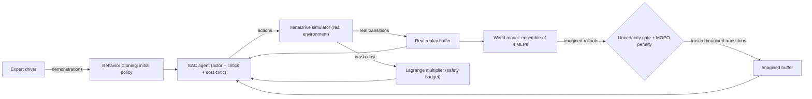
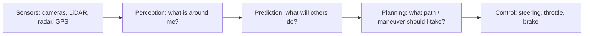
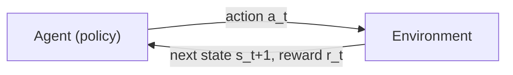
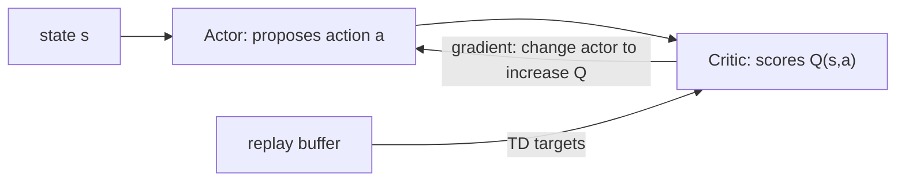
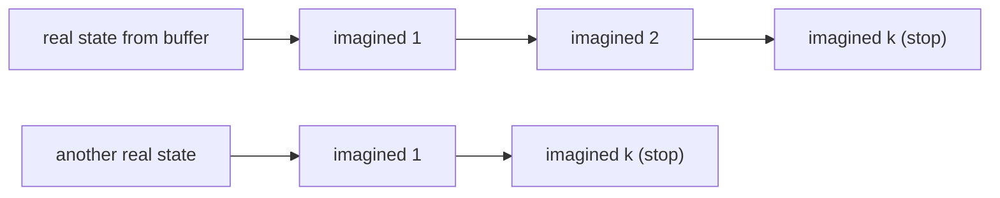
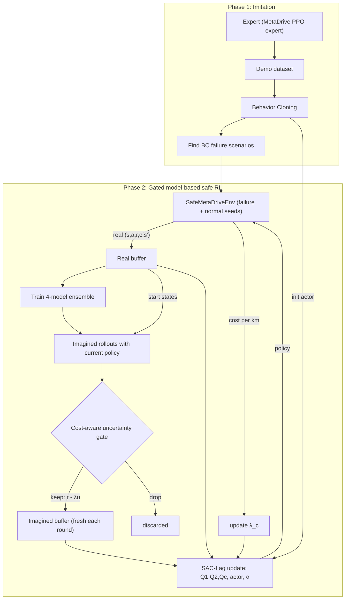

# GATE-SAC Foundations: From Zero to the Full Project

*A self-study guide for someone new to autonomous driving and deep RL. Read it top to bottom; each part builds on the previous one.*

---

## How to Read This Guide

| Part | Topic | You'll be able to answer… |
|---|---|---|
| 0 | The project in one picture | "What are we actually building?" |
| 1 | Autonomous driving basics | "What does a self-driving car need to do?" |
| 2 | Simulators & MetaDrive | "What does our car 'see', and how does it act?" |
| 3 | Reinforcement learning basics | "How does an agent learn from trial and error?" |
| 4 | Deep RL & actor-critic | "How do neural networks fit into RL?" |
| 5 | Soft Actor-Critic (SAC) | "How does our core learning algorithm work?" |
| 6 | Imitation learning | "Why start by copying an expert?" |
| 7 | Model-based RL & world models | "What does 'learning in imagination' mean?" |
| 8 | Uncertainty, ensembles, gating, MOPO | "How do we know when the imagination is lying?" |
| 9 | Safe RL & Lagrangian constraints | "How do we force the car to stay safe?" |
| 10 | GATE-SAC end to end | "How do all the pieces connect?" |
| 11 | Doing the science right | "How do we prove it works?" |
| 12 | Our feasibility results explained | "What did the test script tell us?" |
| 13 | Glossary & reading path | Quick lookup + what to read next |

---

## Part 0: The Project in One Picture

**Goal:** teach a simulated car to drive **safely**, using **as little simulator time as possible**.

The strategy has four ideas stacked together:

1. **Copy an expert first** (Imitation Learning). The car learns basic driving by watching.
2. **Improve by trial and error** (Reinforcement Learning, specifically SAC). The car gets better than the expert, especially in situations where the expert fails.
3. **Practice in a learned "imagination"** (Model-Based RL). A neural network learns to predict "if I do X here, what happens next?". The car practices inside that prediction, which is much cheaper than running the simulator.
4. **Don't trust the imagination blindly** (Uncertainty Gating + Pessimism + Safety constraints). Four separately trained networks predict the future. Where they **disagree**, we stop imagining or penalize the reward. A safety system keeps the crash rate under a budget.



Don't worry if the words are unfamiliar. Every box is explained below.

---

## Part 1: Autonomous Driving Basics

### 1.1 What does a self-driving car have to do?

The classic pipeline (often called the **"AV stack"**) splits driving into modules:



| Module | Question | Example output |
|---|---|---|
| **Perception** | What objects are around me? | "Car 12 m ahead, lane line 1.6 m to my left" |
| **Prediction** | What will they do next? | "That car will merge into my lane in 2 s" |
| **Planning** | What should I do? | "Slow down and stay in lane" |
| **Control** | How do I execute it? | steer = −0.05, throttle = 0.3 |

There are two philosophies:
- **Modular:** hand-design each block (industry has historically done this).
- **End-to-end / learned:** a neural network maps sensor inputs directly to controls. **Our project is end-to-end for decision + control.** The policy network takes sensor readings and outputs steering and throttle.

> [!NOTE]
> We skip hard perception (detecting cars in camera images). MetaDrive gives us clean, pre-processed sensor vectors. That lets us focus on the **decision-making** part, which is where RL lives. Images are a stretch goal (Dreamer-SAC uses them).

### 1.2 Key vocabulary

- **Ego vehicle:** *our* car (the one being controlled). Everyone else is "traffic" or "other agents".
- **Lane / lane center / lateral offset:** how far left or right of the lane's middle line the car is.
- **Heading:** the direction the car points. **Heading error** is the angle between the car's heading and the road direction.
- **Longitudinal vs lateral:** longitudinal = along the road (forward/back, speed, braking). Lateral = sideways (steering, lane keeping).
- **Route / navigation:** the path to the destination. The car is told "your next checkpoint is there".
- **Kinematics / dynamics:** the physics of how position, speed, and heading change given steering and throttle. You can't teleport or turn instantly; momentum matters.

### 1.3 Sensors in our project

**LiDAR** (Light Detection and Ranging) spins a laser and measures **distance** to the nearest object in each direction.

- A **"1D LiDAR array"** is a list of distances, one per angle. For example, 240 rays spread over 360°.
- Ray *i* says "the nearest thing in direction θᵢ is d meters away." The value is normalized to [0,1], so 1.0 = nothing within range (e.g., 50 m).
- When a car ahead gets closer, the values for the forward-pointing rays **shrink**. That's how the policy "sees" traffic.

```
            ray 0 (front)
               |
   ray 180 ----🚗---- ray 60
               |
            ray 120 (back)
   value = distance / max_range   (0 = touching, 1 = clear)
```

A **camera** gives an image (an H×W×3 array of pixels). It carries much more information but is harder to learn from. Dreamer-SAC uses both camera and LiDAR. We use only vectors.

### 1.4 Actions: how the car is controlled

Our policy outputs **two continuous numbers** every step:

| Dimension | −1.0 | 0.0 | +1.0 |
|---|---|---|---|
| `steer` | full left | straight | full right |
| `throttle` | full brake | coast | full gas |

"Continuous" means any real number in the range (e.g., 0.137), not a fixed menu like {left, straight, right}. This matters because it rules out some RL algorithms (like DQN) and motivates SAC.

### 1.5 How do we measure "good driving"?

| Metric | Meaning | Why it matters |
|---|---|---|
| **Success rate** | % of episodes reaching the destination | Overall competence |
| **Route completion** | % of the route driven before the episode ended | Partial credit |
| **Collisions per km** | crashes ÷ km driven | Safety, normalized by distance. A car that never moves has 0 crashes but also 0 km! |
| **Out-of-road per km** | leaving the road ÷ km | Safety |
| **Average speed** | km/h | Efficiency (too slow = useless) |
| **Return** | sum of rewards | What RL optimizes (defined in Part 3) |

> [!WARNING]
> **Classic trap:** a car that stays parked has zero collisions. Always report safety metrics **together with** progress metrics. Your earlier Colab prototype fell into exactly this trap.

### 1.6 Why not just test in the real world?

Real-world testing is **expensive, slow, and dangerous**. Crashes are rare events, so you'd need millions of km to see enough of them. That's why the field uses **simulators** and **logged real data**.

- **Waymo Open Dataset:** millions of real driving logs (positions of every car over time).
- **ScenarioNet:** a tool that converts such logs into scenarios a simulator (MetaDrive) can replay.
- **Log replay** means other cars follow their recorded paths. They are **non-reactive**: if you brake suddenly, the car behind won't react, because it just follows the recording. This is an important limitation.
- **Logs record trajectories (positions), not steering/throttle commands.** To imitate them you must infer the actions (*inverse dynamics*). This is why the plan moved Waymo to a stretch goal.

---

## Part 2: Simulators & MetaDrive

### 2.1 MetaDrive in one paragraph

MetaDrive is an open-source driving simulator built on a game engine (Panda3D) with a physics engine (Bullet). It can **procedurally generate** unlimited road maps by connecting "blocks" (straight, curve, intersection, roundabout, ramp…). It also spawns traffic and gives you an RL-friendly interface: `obs, reward, terminated, truncated, info = env.step(action)`.

### 2.2 Key concepts in MetaDrive

| Concept | Meaning |
|---|---|
| **Scenario / seed** | A specific generated map + traffic layout. Seed 5 always produces the same map. |
| `num_scenarios`, `start_seed` | Which set of maps to train on. Use **different seeds for testing** to measure generalization. |
| `map=3` | Maps made of 3 random blocks. A string like `"SCS"` = straight-curve-straight. |
| `traffic_density` | How many other cars (0.1 ≈ 30 vehicles/km). |
| **Episode** | One drive from start until success, crash, off-road, or time limit (`horizon`). |
| **Step** | One decision. The policy acts, physics advances a short time (~0.1 s by default), and a new observation arrives. |
| `info` dict | Extra facts per step: `crash_vehicle`, `out_of_road`, `arrive_dest`, `cost`… |
| **SafeMetaDriveEnv** | A variant with static obstacles and a built-in **cost** signal (1 for crash/out-of-road). Designed for safe RL, so it fits our project well. |

### 2.3 Our observation vector (259 numbers)

In the feasibility test, `obs_dim = 259`. In MetaDrive's default "state" observation, that roughly breaks down as:

| Part | Size | Contains |
|---|---|---|
| Ego state | ~9 | distance to left/right road edges, heading error, speed, steering, last action, yaw rate, lateral position |
| Navigation | ~10 | direction/distance to the next route checkpoints, road curvature |
| LiDAR | 240 | distance to nearest object per ray |

Every value is normalized to roughly **[0, 1]**. That's why the feasibility script **clips** predicted states to [0,1].

### 2.4 MetaDrive's default reward (roughly)

Per step:

$$ r = \underbrace{c_d \cdot \Delta x_{\text{longitudinal}}}_{\text{progress along route}} + \underbrace{c_s \cdot \frac{v}{v_{max}}}_{\text{speed bonus}} - \underbrace{\text{penalty}}_{\text{crash / off-road}} + \underbrace{\text{bonus}}_{\text{arrived}} $$

In words: **move forward along your route, at a decent speed, and don't crash.** Your proposal adds a **lane-deviation penalty** (stay near the lane center). Dreamer-SAC uses the same structure (its eq. 14–17).

### 2.5 The "expert" in MetaDrive

MetaDrive ships a **pre-trained PPO driving policy** (`metadrive.examples.ppo_expert.numpy_expert.expert`). It's an RL agent someone already trained. It's decent but imperfect (it reached the destination in about 33% of episodes on our harder maps). That's actually useful: it gives RL something to improve on.

---

## Part 3: Reinforcement Learning Basics

### 3.1 The core loop



At every time step *t*:
1. The agent observes **state** $s_t$ (our 259 numbers).
2. It picks an **action** $a_t$ (steer, throttle).
3. The environment returns a **reward** $r_t$ (a number: good or bad) and the **next state** $s_{t+1}$.
4. Repeat until the episode ends.

The agent's goal is to **maximize total reward over time**, not just the next reward. Example: braking now (slightly less progress) avoids a crash later (a huge penalty).

### 3.2 The Markov Decision Process (MDP)

An MDP formalizes this loop as a tuple $(\mathcal{S}, \mathcal{A}, P, R, \gamma)$:

| Symbol | Name | In our project |
|---|---|---|
| $\mathcal{S}$ | State space | 259-dim vectors in [0,1] |
| $\mathcal{A}$ | Action space | $[-1,1]^2$ (steer, throttle) |
| $P(s' \mid s,a)$ | Transition function | MetaDrive physics + traffic behavior |
| $R(s,a)$ | Reward function | progress − lane deviation (− crash penalty) |
| $\gamma$ | Discount factor | 0.99: future rewards count slightly less than immediate ones |

**Markov property:** the next state depends only on the current state and action, not on the full history. Real driving isn't perfectly Markov: you can't see the other driver's intentions. The formal name for that is a **POMDP** (Partially Observable MDP), which is what Dreamer-SAC uses. For vector states we usually pretend it's an MDP, and it works reasonably well.

### 3.3 Policy, return, and value

- **Policy** $\pi(a \mid s)$: the agent's behavior, i.e. the probability of choosing action *a* in state *s*. Our policy is a neural network.
- **Return** $G_t$: the discounted sum of future rewards.
$$ G_t = r_t + \gamma r_{t+1} + \gamma^2 r_{t+2} + \dots $$
  With γ = 0.99, a reward 100 steps in the future is worth $0.99^{100} \approx 0.37$ of an immediate one.
- **Value function** $V^\pi(s)$: the *expected* return starting from state *s* and following π. "How good is it to be here?"
- **Action-value (Q) function** $Q^\pi(s,a)$: the expected return if you take action *a* in *s* and then follow π. "How good is it to do *this* here?"

**Driving intuition:** a state 2 m behind a braking truck at 80 km/h has a **low V** (a crash is likely). Q(that state, brake hard) is higher than Q(that state, accelerate).

### 3.4 The Bellman equation: the heart of RL

Value satisfies a recursive relation:

$$ Q^\pi(s,a) = r(s,a) + \gamma \, \mathbb{E}_{s' \sim P,\, a' \sim \pi}\big[ Q^\pi(s', a') \big] $$

In words: **the value of doing *a* now = immediate reward + discounted value of wherever you end up.**

We use this to *learn* Q. Collect a transition $(s, a, r, s')$, compute the **target**
$y = r + \gamma Q(s', a')$, and nudge $Q(s,a)$ toward $y$. This is called **Temporal-Difference (TD) learning**. The difference $y - Q(s,a)$ is the **TD error**.

If the episode **terminates** at $s'$ (a crash), there is no future: $y = r$. That's why code uses `(1 - done)` in the target.

### 3.5 Important distinctions

| Distinction | Meaning | Our choice |
|---|---|---|
| **Exploration vs exploitation** | Try new actions to learn, or use what you know works? | SAC explores via a random (stochastic) policy |
| **On-policy vs off-policy** | On-policy can only learn from data generated by the *current* policy. Off-policy can reuse *any* old data. | **Off-policy (SAC).** This lets us reuse old data and add imagined data |
| **Model-free vs model-based** | Learn directly from experience, or also learn a model of the environment? | **Both.** SAC is model-free; we add a learned model (Part 7) |
| **Episodic vs continuing** | Does it end? | Episodic (crash, success, timeout) |

### 3.6 The replay buffer

Off-policy methods store every transition $(s, a, r, s', \text{done})$ in a big table called the **replay buffer**. Each training step samples a random **mini-batch** (e.g., 256 transitions). This:
- reuses expensive data many times (sample efficiency)
- breaks correlations between consecutive steps, which stabilizes learning

GATE-SAC uses **two** buffers: a **real** one (from the simulator) and an **imagined** one (from the world model).

### 3.7 Sample efficiency

**Sample efficiency** = how much performance you get per real environment step. It's *the* motivation for model-based RL. In real driving, every step is costly; in simulation, it's time. "Dreamer-SAC reaches higher return in 40k steps" is a sample-efficiency claim.

---

## Part 4: Deep RL & Actor-Critic

### 4.1 Why neural networks?

With 259 continuous inputs, you cannot store Q in a table. Instead we **approximate** functions with neural networks:
- **Critic** $Q_\theta(s,a)$: input state + action, output a single number (estimated return).
- **Actor** $\pi_\phi(a \mid s)$: input state, output an action distribution.

An **MLP** (Multi-Layer Perceptron) is the basic network: layers of `Linear → activation (ReLU/SiLU)`. "2 layers of 256 units" means two hidden layers, each with 256 neurons. All our networks are MLPs.

### 4.2 Actor-critic



- The **critic** learns "how good is (s,a)?" from data, using Bellman/TD targets.
- The **actor** learns to output actions the critic scores highly.
- They improve together, like a student (actor) and a judge (critic) who is also learning.

### 4.3 Stabilization tricks (you'll see these in code)

| Trick | Problem it solves | How |
|---|---|---|
| **Target networks** $Q_{\bar\theta}$ | Chasing a moving target: Q's target depends on Q itself | Keep a slowly-updated copy for computing targets: $\bar\theta \leftarrow \tau\theta + (1-\tau)\bar\theta$, with τ = 0.005 ("Polyak averaging") |
| **Twin critics** (Clipped Double-Q) | Q-learning **overestimates** values (max over noisy estimates is biased upward) | Train two critics and use the **minimum** in targets |
| **Replay buffer** | Correlated data | Random mini-batches |
| **Observation normalization** | Inputs on different scales | Standardize inputs (as in the feasibility script's world model) |

### 4.4 Continuous actions: Gaussian policy + tanh

For continuous actions, the actor outputs a **mean μ** and **standard deviation σ** for each action dimension. It then samples $u \sim \mathcal{N}(\mu, \sigma)$ and squashes with $a = \tanh(u)$ so actions land in [−1, 1].

The **reparameterization trick** writes $u = \mu + \sigma \cdot \epsilon$ with $\epsilon \sim \mathcal{N}(0,1)$. The randomness is now outside the network, so gradients can flow through μ and σ. This is how SAC's actor gets trained.

---

## Part 5: Soft Actor-Critic (SAC)

SAC (Haarnoja et al., 2018) is the go-to off-policy algorithm for continuous control. It's stable, sample-efficient, and explores well.

### 5.1 The key idea: maximum entropy

Standard RL maximizes reward. SAC maximizes **reward + entropy**:

$$ J(\pi) = \sum_t \mathbb{E}\big[ r(s_t,a_t) + \alpha \, \mathcal{H}(\pi(\cdot \mid s_t)) \big] $$

- **Entropy** $\mathcal{H}$ measures how random the policy is. High entropy = spread-out actions.
- **Temperature α** trades off reward vs randomness.
- **Why?** The agent is rewarded for staying random unless being precise really pays off. That gives built-in exploration, robustness, and avoids collapsing early onto a mediocre behavior.

### 5.2 The three SAC updates

**1. Critic update (soft Bellman target).** For a transition $(s,a,r,s',d)$, sample $a' \sim \pi(\cdot \mid s')$:

$$ y = r + \gamma (1-d)\Big( \min_{i=1,2} Q_{\bar\theta_i}(s',a') - \alpha \log \pi(a' \mid s') \Big) $$

Minimize $(Q_{\theta_i}(s,a) - y)^2$ for both critics. The $-\alpha \log\pi$ term is the "soft" (entropy) bonus.

**2. Actor update.** Sample $a = \tanh(\mu_\phi(s) + \sigma_\phi(s)\epsilon)$ and minimize:

$$ L_\pi = \mathbb{E}\big[ \alpha \log \pi(a \mid s) - \min_i Q_{\theta_i}(s,a) \big] $$

In words: pick actions with **high Q**, while staying **random** (low log-prob).

**3. Temperature update (automatic α).** Pick a target entropy (commonly $-|\mathcal{A}| = -2$ for 2 actions) and adjust α automatically. If the policy becomes too deterministic, α goes up; if it's too random, α goes down.

### 5.3 SAC pseudocode

```
for each environment step:
    a ~ π(s);  s', r, d = env.step(a);  buffer.add(s,a,r,s',d)
    for G gradient steps:              # G = "update-to-data ratio" (UTD)
        batch = buffer.sample(256)
        update critics Q1, Q2 toward soft Bellman target
        update actor to maximize  min Q − α log π
        update α toward target entropy
        soft-update target critics
```

Typical hyperparameters: learning rate 3e-4, γ = 0.99, τ = 0.005, batch 256, networks 2×256. Dreamer-SAC uses these too.

---

## Part 6: Imitation Learning (IL)

### 6.1 Behavior Cloning (BC)

**Idea:** treat driving as supervised learning. Collect expert pairs (state, expert action) and train a network to predict the action:

$$ L_{BC} = \mathbb{E}_{(s,a^*) \sim \mathcal{D}_{expert}} \big\| \pi(s) - a^* \big\|^2 $$

It's simple and fast, and it immediately gives a car that roughly drives.

### 6.2 Why BC alone fails: covariate shift and compounding errors

The expert only visited "good" states. When the BC policy makes a small mistake, it drifts into a state the expert **never visited**. There it has no idea what to do, so it makes a bigger mistake, drifts further, and eventually crashes.

```
expert path:   ────────────────────────────►
BC policy:     ──────╲
                       ╲___  (unfamiliar states)
                            ╲___💥
```

This is the **covariate shift** problem (Codevilla et al., Ross et al./DAgger). It's exactly why the proposal says *"RL is used to fix failures in imitation models."* RL experiences its *own* mistakes and learns to recover.

### 6.3 IL → RL fine-tuning, and its pitfall

The plan is to start SAC's actor from the BC weights so RL doesn't have to rediscover basic driving.

**The pitfall:** the critic starts random. Its gradients initially point in garbage directions, so the actor quickly **"unlearns"** the good BC behavior. Standard fixes:
1. **Critic warm-up:** freeze the actor and train the critics on BC-policy data first.
2. **BC regularization:** add $\beta \cdot L_{BC}$ to the actor loss and slowly decay β to 0.
3. Put expert data in the replay buffer.

### 6.4 Failure-set fine-tuning (recommended framing)

Run the BC policy on hundreds of scenarios, record which ones it fails (crashes, off-road), and focus RL training on that **failure set** (mixed with normal scenarios). Now "RL fixes IL failures" becomes a measurable claim.

---

## Part 7: Model-Based RL & World Models

### 7.1 What is a "world model"?

A **dynamics model** (or **world model**) is a neural network that learns to imitate the environment:

$$ f_\psi(s_t, a_t) \rightarrow (\hat s_{t+1}, \hat r_t, \hat d_t) $$

"Given where I am and what I do, predict where I'll be, what reward I'll get, and whether the episode ends."

We train it with **supervised learning** on the real replay buffer: the inputs are $(s,a)$ and the labels are the real $(s', r, d)$.

**Trick:** predict the **change** $\Delta s = s_{t+1} - s_t$ instead of $s_{t+1}$ directly. Most of the state barely changes per step, so the change is easier to learn. The feasibility script does this.

### 7.2 Why bother? "Learning in imagination"

The model can be queried thousands of times per second (our test: ~37,000 imagined transitions/s, versus ~190 real simulator steps/s). The agent can generate huge amounts of **synthetic experience** cheaply. Classic name: **Dyna** (Sutton, 1990).

### 7.3 The catch: compounding model error

Predict 1 step → small error. Feed that prediction back in to predict step 2 → the error grows. After many steps, the imagined world drifts into nonsense.

```
real:      s0 → s1 → s2 → s3 → s4 → s5
imagined:  s0 → ŝ1 → ŝ2 → ŝ3 → ŝ4 → ŝ5
error:          small   ↑     ↑↑    ↑↑↑   ↑↑↑↑
```

Worse, the RL agent will **exploit** model errors. If the model wrongly believes "driving through this car gives +10 reward", the policy will learn to do it. This is called **model exploitation** or **model bias**.

Our feasibility test measured this directly: by about **6 steps**, the model's prediction is no better than guessing the average state.

### 7.4 MBPO: short branched rollouts (our base method)

**Model-Based Policy Optimization** (Janner et al., 2019) solves compounding error with **short rollouts that branch off real states**:



1. Sample many **real** states from the replay buffer.
2. From each, roll the model forward a **fixed short horizon k** (1–5 steps), choosing actions with the current policy.
3. Put those imagined transitions in an imagined buffer.
4. Train SAC mostly on imagined data (e.g., 95% imagined + 5% real), with many gradient updates per real step (a high **UTD ratio**).

Since rollouts are short and start from real states, errors don't have time to compound much. MBPO also uses an **ensemble** of models (Part 8).

**GATE-SAC's core change:** instead of a fixed *k*, stop each rollout **adaptively** when the model becomes uncertain.

### 7.5 Dreamer and the RSSM (background for the stretch goal)

**Dreamer** (Hafner et al.) learns a world model from **images**. It compresses each image into a small **latent state** and predicts the future in that latent space, using a **Recurrent State-Space Model (RSSM)**:
- a deterministic recurrent memory $h_t$ (like an RNN), plus
- a stochastic latent $z_t$ capturing uncertainty.

The actor-critic is trained **entirely in imagination**, on-policy.

### 7.6 Dreamer-SAC (the paper that inspired GATE-SAC)

Dreamer-SAC combines Dreamer's RSSM with **off-policy SAC**:
- Real data trains the RSSM. Short (H = 5) latent rollouts start from real latent states.
- SAC trains on **real + imagined** data. The imagined buffer is **discarded every iteration** so it never goes stale.
- Real transitions use **1-step TD targets**; imagined rollouts use **n-step targets**:

$$ y^{pred}_t = \sum_{k=0}^{N-1} \gamma^k r_{t+k} + \gamma^N \big( \min_i Q(s_{t+N}, a_{t+N}) - \alpha\log\pi(a_{t+N}\mid s_{t+N}) \big) $$

  In words: sum the actual predicted rewards along the rollout, and only bootstrap with Q at the end. This propagates reward information faster.
- **Key findings:** an *inverted-U* in horizon (H=5 best; longer hurts due to model bias), real data matters, and n-step beats 1-step.
- **Their stated future work:** "adaptive rollout strategies that dynamically adjust rollout length according to model reliability and uncertainty." That is literally GATE-SAC's idea.

| | MBPO | Dreamer-SAC | **GATE-SAC** |
|---|---|---|---|
| Input | state vectors | images + vectors | state vectors |
| World model | MLP ensemble | RSSM (latent) | MLP ensemble (4) |
| Rollout length | fixed k | fixed H=5 | **adaptive (uncertainty gate)** |
| Reward pessimism | no | no | **yes (MOPO penalty)** |
| Safety constraint | no | no | **yes (Lagrangian cost critic)** |
| IL initialization | no | no | **yes (BC)** |

---

## Part 8: Uncertainty, Ensembles, Gating, and MOPO

### 8.1 Two kinds of uncertainty

| Type | Meaning | Driving example | Reducible with more data? |
|---|---|---|---|
| **Aleatoric** | Inherent randomness in the world | Will the other driver brake or not? Truly random from our view | ❌ No |
| **Epistemic** | The model's *ignorance* due to lack of data | The model has never seen a roundabout | ✅ Yes |

For the gate we care mostly about **epistemic** uncertainty: "the model doesn't know here, so don't trust it."

### 8.2 Ensembles: measuring ignorance by disagreement

Train **several** models (we use 4), each with different random initialization and a different **bootstrap** sample of the data (sampled with replacement).

- Where there's lots of data, all models converge to similar answers → **they agree**.
- Where data is scarce, each model extrapolates differently → **they disagree**.

So the **disagreement** (variance across the models' predictions) is a practical estimate of epistemic uncertainty:

$$ u(s,a) = \frac{1}{D}\sum_{j=1}^{D} \text{Var}_{i=1..4}\big[\hat s^{(i)}_{t+1,j}\big] $$

(The variance across the 4 members, averaged over the D state dimensions. This is what `u = next_s.var(0).mean(-1)` computes in the feasibility script.)

### 8.3 Probabilistic models (Gaussian heads)

Each model can output both a **mean** and a **variance** for its prediction (a Gaussian). It's trained with **Gaussian negative log-likelihood**:

$$ L = \frac{(\mu - y)^2}{\sigma^2} + \log \sigma^2 $$

- The per-model variance σ² captures **aleatoric** noise.
- The disagreement between models' means captures **epistemic** uncertainty.

MBPO and MOPO use this "probabilistic ensemble". The feasibility script implements it too (the `mu` and `logvar` heads).

### 8.4 Is disagreement actually a good error detector? (calibration)

Only if high *u* ↔ high *true error*. We measured this with **Spearman rank correlation** (1.0 = perfect ranking, 0 = no relation):
- Result: **≈ 0.5**. Useful but noisy.
- Transitions in the top 10–20% by *u* had **4–5× higher error** than the rest. So gating on *u* does remove the worst predictions.

### 8.5 The Uncertainty Gate (adaptive truncation)

During each imagined rollout, at every step:

```
if u(s, a) > threshold:
    stop this rollout here (don't store this transition or anything after it)
```

This gives each rollout its own length: long where the model is confident (a straight empty road), short where it isn't (dense traffic near an intersection). Related work: Wu et al. 2021 (adaptive truncation for driving), MACURA, and M2AC (Pan et al. 2020).

**Choosing the threshold.** The raw scale of *u* is tiny and changes during training (we measured ~1e-5). So a fixed number like 0.08 never fires. Better options:
- **Percentile gate:** truncate the top p% most uncertain transitions (e.g., p = 20%), recomputed each batch.
- **Normalize** *u* by its running median so "ũ = 3" means "3× more uncertain than usual".

### 8.6 MOPO: the pessimistic reward penalty

**MOPO** (Yu et al., 2020) was designed for offline RL. Instead of discarding uncertain transitions, it **lowers their reward**:

$$ \tilde r = \hat r - \lambda \, u(s,a) $$

The agent now prefers well-understood states. The model can't "promise" fake rewards in regions it doesn't know. λ controls how cautious (risk-averse) the agent is.

**Gate vs penalty: complementary tools.**
| | Gate (hard) | Penalty (soft) |
|---|---|---|
| Effect | Removes the transition | Keeps it, makes it less attractive |
| Risk | May hide important states (e.g., right before a crash) | Too small λ = no effect; too big = overly timid car |

### 8.7 The near-crash problem (confirmed in our test)

Our test found disagreement is **1.86× higher in the 5 steps before a crash**. That makes sense: crashes are rare, so the model has little data about them. But it means a naive gate **deletes exactly the experiences that teach crash avoidance.** The proposed fix is a **cost-aware gate**: if the models predict a crash, keep the transition as a terminal "crash" (cost = 1) instead of discarding it.

---

## Part 9: Safe RL & Lagrangian Constraints

### 9.1 Why not just add a big crash penalty to the reward?

You can, but:
- How big? Too small → the car takes risks. Too big → the car refuses to move.
- It mixes two goals into one number, so you can't specify "at most 0.5 collisions per km".

### 9.2 Constrained MDP (CMDP)

Add a separate **cost** signal $c_t$ (1 when a crash/off-road happens, else 0) and a **budget** $d$:

$$ \max_\pi \; \mathbb{E}\Big[\sum_t \gamma^t r_t\Big] \quad \text{subject to} \quad \mathbb{E}\Big[\sum_t \gamma^t c_t\Big] \le d $$

"Drive as well as possible, **as long as** the expected crash cost stays under budget."

### 9.3 Lagrangian relaxation: turning a constraint into a learnable penalty

Introduce a **Lagrange multiplier** λ_c ≥ 0 and solve:

$$ \min_{\lambda_c \ge 0} \; \max_\pi \; \mathbb{E}[R] - \lambda_c \big( \mathbb{E}[C] - d \big) $$

In practice you alternate two updates:
1. **Policy step:** improve π on reward minus λ_c × cost.
2. **Multiplier step (dual ascent):**
$$ \lambda_c \leftarrow \max\big(0,\; \lambda_c + \eta\,(\hat C - d)\big) $$
   If the measured cost is **above** budget, λ_c increases (safety matters more). If it's **below**, λ_c decreases (focus on driving well).

Think of λ_c as an **automatic thermostat for caution**.

### 9.4 SAC-Lagrangian

- Add a **cost critic** $Q_c(s,a)$ that predicts expected future cost, trained with its own Bellman target $y_c = c + \gamma(1-d) Q_c(s',a')$.
- Actor loss becomes:
$$ L_\pi = \mathbb{E}\big[\alpha \log\pi(a\mid s) - \min_i Q_i(s,a) + \lambda_c \, Q_c(s,a)\big] $$
- **Don't** also put the crash penalty in the reward, or you count it twice.

### 9.5 Converting "collisions per km" into a budget

Measure it from **real** episodes: `cost_per_km = (#crashes + #off-road) / km_driven`. Update λ_c from that number versus the target (e.g., 0.5/km). This matches the evaluation metric exactly, and it isn't fooled by an inaccurate cost critic.

### 9.6 Common failure modes

- **Oscillation:** λ_c swings up and down. Fix with a smaller η or a PID-Lagrangian.
- **Frozen car:** λ_c grows huge and the car stops. Check route completion, use critic warm-up, and make sure the reward doesn't double-count crashes.

---

## Part 10: GATE-SAC End to End

### 10.1 Full pipeline



### 10.2 One training iteration in plain English

1. **Drive** one step in the real simulator with the current policy. Save it.
2. Every few hundred steps, **retrain the 4 world models** on all real data.
3. **Imagine:** pick a few thousand real states. From each, let the policy "drive" inside the world models for up to 5 steps. At each step:
   - compute disagreement *u* (normalized)
   - if the models predict a **crash** → save it as a crash ending and stop
   - else if *u* is too high → **stop** (gate)
   - else save the transition with reward $\hat r - \lambda u$ (penalty)
4. **Learn:** many SAC updates on batches mixing real and imagined data. Use 1-step targets for real data and n-step targets for imagined rollouts. Update the reward critics, cost critic, actor, and α.
5. After each episode, **adjust λ_c** based on real collisions/km versus the budget.
6. Throw away the imagined buffer and repeat.

### 10.3 Which concept powers which part?

| Component | Concept (Part) | Purpose |
|---|---|---|
| BC initialization | IL (6) | Start from a car that already drives |
| SAC | Max-entropy actor-critic (5) | Stable off-policy learning with continuous actions |
| Ensemble world model | MBRL (7), Ensembles (8) | Cheap synthetic experience + uncertainty estimate |
| Uncertainty gate | Adaptive truncation (8.5) | Stop imagining where the model is unreliable |
| MOPO penalty | Pessimism (8.6) | Discourage exploiting model errors |
| Cost-aware gate | (8.7) | Don't hide near-crash experiences |
| Cost critic + λ_c | CMDP / Lagrangian (9) | Keep collisions/km under budget |
| n-step imagined targets | Dreamer-SAC (7.6) | Better use of rollout rewards |

### 10.4 Hyperparameter cheat sheet

| Name | Typical value | Effect of increasing it |
|---|---|---|
| Ensemble size E | 4 (proposal), 5–7 (MBPO) | Better uncertainty, slower |
| Max horizon H | 5 | More imagined data, more model bias |
| Gate percentile p | drop top 10–30% | More truncation, safer but less data |
| MOPO λ | 0.1–1 (on normalized u) | More cautious, possibly timid |
| Real-data ratio | 5–50% | More grounded, less benefit from the model |
| UTD (updates per env step) | 10–20 | Faster learning, risk of overfitting |
| Cost budget d | e.g., 0.5 collisions/km | Lower = safer, slower driving |
| Dual LR η | small (1e-3 to 1e-2) | Faster λ_c reaction, more oscillation |

---

## Part 11: Doing the Science Right

### 11.1 Baselines and ablations

- A **baseline** is a reference method you compare against (BC only, SAC, SAC-Lag, MBPO with fixed horizon).
- An **ablation** removes one component at a time (gate only, penalty only, cost-unaware gate) to show **which part** caused the improvement.

### 11.2 Seeds and confidence intervals

RL results vary a lot between random seeds. Run **≥3 (ideally 5) seeds** per method. Plot the **mean ± standard error** (shaded) or 95% confidence intervals. A single-seed "win" is not evidence.

### 11.3 Train/test split

Train on scenario seeds 0–99 and evaluate on **unseen** seeds (e.g., 1000+). Otherwise you're measuring memorization, not driving skill.

### 11.4 Reading a learning curve

- **x-axis:** real environment steps (not wall-clock or gradient steps). This is the sample-efficiency view.
- **y-axis:** evaluation return / success rate / collisions per km.
- Compare **how fast** each curve rises (efficiency) and **where it ends up** (final performance).

### 11.5 Reward hacking sanity checks

Always watch a few rollout videos. If return looks good but the car circles in place or stops, the reward or constraint is being exploited.

---

## Part 12: Our Feasibility Results Explained

The script [feasibility_test.py](file:///Users/spoorthy/Documents/SEM%20III/DRL/GATE-SAC-DRL-project/feasibility/feasibility_test.py) checks the project's assumptions **before** building the RL system.

| Test | What it does | Result | Concept |
|---|---|---|---|
| **T1** throughput | Times real simulator steps | ~190 steps/s | Sample cost (3.7) |
| **T2** expert | Runs MetaDrive's PPO expert, with and without noise | Works; 33% success clean | IL data source (2.5, 6) |
| **T3** model error vs horizon | Trains the 4-model ensemble, then rolls it forward from held-out real states using the **real** action sequence and compares to the real future | Error ×3.6 by step 5; ≈ "useless" by step 6 | Compounding error (7.3) → keep H ≤ 5 |
| **T4** gate validity | Correlates disagreement *u* with true error | Spearman ≈ 0.5; top-20% u = 4–5× error | Ensembles as uncertainty (8.2–8.4) |
| **T4** scale | Prints raw *u* | ~1e-5 → fixed threshold 0.08 never fires | Normalize / percentile gate (8.5) |
| **T5** pre-crash *u* | Compares *u* right before crashes vs normal | 1.86× higher before crashes | Near-crash problem (8.7) |
| **T5** cost AUC | How well the ensemble predicts crash events (0.5 = random, 1 = perfect) | 0.78 | Imagined costs are weak → update λ_c from real data (9.5) |
| **T6** imagination speed | Imagined transitions per second | ~37,000/s | Why MBRL is attractive (7.2) |

**Code-reading map for the script:**
- `collect()`: the agent–environment loop (Part 3.1) with the expert policy + exploration noise.
- `Member` / `Ensemble`: a probabilistic MLP world model predicting Δs, reward, and crash probability (Parts 7.1, 8.3).
- `Ensemble.fit`: bootstrap sampling + Gaussian NLL + weighted BCE for rare crashes.
- `Ensemble.predict`: returns the mean next state, reward, cost, and **disagreement u**.
- Open-loop rollout loop in `main()`: measures compounding error (7.3) and the u↔error correlation (8.4).

---

## Part 13: Glossary & Reading Path

### Glossary

| Term | Short definition |
|---|---|
| **Action space** | Set of possible actions; ours is $[-1,1]^2$ |
| **Actor / Critic** | Policy network / value network |
| **Ablation** | Experiment removing one component to measure its contribution |
| **Aleatoric uncertainty** | Inherent randomness; can't be reduced |
| **Bellman equation** | Value = reward + discounted next value |
| **Behavior Cloning (BC)** | Supervised learning of expert actions |
| **Bootstrap (stats)** | Resampling the data with replacement (for ensemble diversity) |
| **Bootstrap (RL)** | Using your own value estimate inside a target |
| **CMDP** | MDP with cost constraints |
| **Compounding error** | Model errors growing over multi-step predictions |
| **Covariate shift** | Test states differ from training states (BC's weakness) |
| **Discount factor γ** | How much future rewards count |
| **Ego vehicle** | The car we control |
| **Ensemble** | Multiple models trained independently |
| **Entropy** | Randomness of a distribution |
| **Epistemic uncertainty** | Uncertainty from lack of data; reducible |
| **Episode** | One run from start to termination |
| **Lagrange multiplier λ_c** | Learned price of violating the safety constraint |
| **LiDAR** | Laser distance sensor; ours is 240 rays |
| **MBPO** | Model-based method with short branched ensemble rollouts |
| **MDP / POMDP** | (Partially observable) Markov decision process |
| **MOPO** | Penalize reward by model uncertainty |
| **n-step target** | Sum n real/predicted rewards before bootstrapping |
| **Off-policy** | Can learn from data generated by other/old policies |
| **Polyak averaging** | Slow target-network update with τ |
| **Q-function** | Expected return of an action in a state |
| **Replay buffer** | Storage of past transitions |
| **Return** | Discounted sum of rewards |
| **RSSM** | Recurrent latent world model used by Dreamer |
| **SAC** | Soft Actor-Critic: max-entropy off-policy actor-critic |
| **Sample efficiency** | Performance per real environment step |
| **ScenarioNet** | Tool converting real driving logs into simulator scenarios |
| **TD error** | Difference between the target and the current value estimate |
| **UTD ratio** | Gradient updates per environment step |
| **World / dynamics model** | Network predicting next state, reward, and done |

### Suggested learning path (about 2 weeks alongside implementation)

1. **RL fundamentals:** [OpenAI Spinning Up, Part 1–3](https://spinningup.openai.com/en/latest/spinningup/rl_intro.html), and Sutton & Barto Ch. 3 & 6 (MDPs, TD learning).
2. **SAC:** [Spinning Up SAC page](https://spinningup.openai.com/en/latest/algorithms/sac.html), then the SAC paper (Haarnoja et al., 2018). Read a [CleanRL SAC implementation](https://github.com/vwxyzjn/cleanrl/blob/master/cleanrl/sac_continuous_action.py) (~300 lines).
3. **MetaDrive:** [docs](https://metadrive-simulator.readthedocs.io/): "Getting started", "Observation", "Reward/cost", Safe RL env.
4. **Imitation learning:** Codevilla et al. 2018; skim DAgger (Ross et al., 2011) for the covariate-shift intuition.
5. **Model-based RL:** MBPO paper "When to Trust Your Model" (Janner et al., 2019). Focus on Sec. 4 (branched rollouts) and the ensemble.
6. **Uncertainty & pessimism:** PETS (Chua et al., 2018) for probabilistic ensembles; MOPO (Yu et al., 2020) Sec. 4.
7. **Adaptive truncation:** Wu et al. 2021 (arXiv:2106.12194); M2AC (Pan et al., 2020).
8. **Safe RL:** Ray et al. 2019 "Benchmarking Safe Exploration" (Lagrangian methods); Stooke et al. 2020 (PID Lagrangian) if λ oscillates.
9. **Dreamer-SAC:** re-read your PDF with Parts 7.5–7.6 in mind.

> [!TIP]
> Fastest way to make this concrete: run the feasibility script, then add `print` statements inside `collect()` to look at a few raw observations, actions, rewards, and `info` dicts. Seeing the numbers makes Parts 2–3 click.
