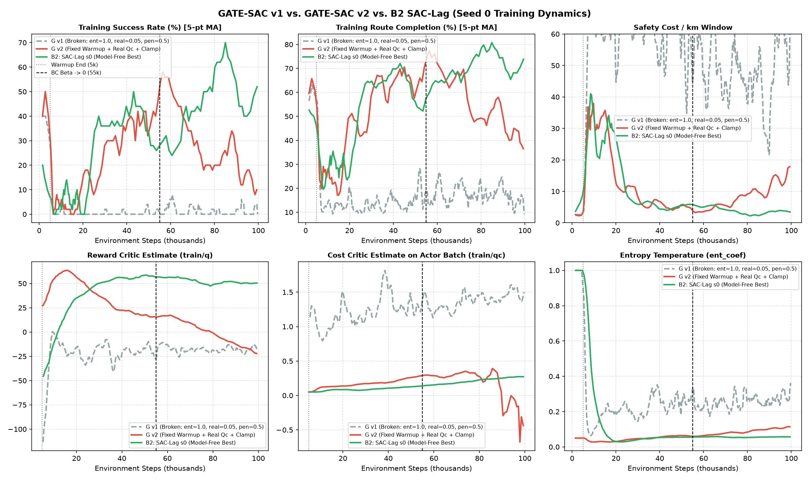
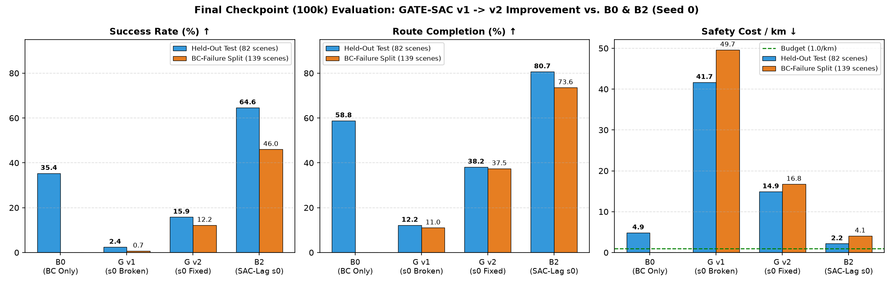

# GATE-SAC v2 Pilot Analysis (`g_gatesac_s0`)

**Scope & Provenance Note:** Only seed 0 of GATE-SAC (`g_gatesac_s0`) has been re-trained and evaluated under the **v2** codebase (`Nov 24`). Seeds `s1`–`s4` in [`runs/sweep/`](../runs/sweep) and [`runs/eval/`](../runs/eval) remain from the **v1** baseline (`Nov 21–22`, commit `2eee99f`), so all **v2** results below compare single-seed `g_gatesac_s0 (v2)` against `g_gatesac_s0 (v1)`, `B0 (BC)`, and `B2 (SAC-Lag s0)`.

---

## Executive Summary

The **v2** theoretical fixes completely eliminated GATE-SAC's **v1** early-training collapse and delivered **`2x` sample efficiency through 50k–60k steps**, before an unguarded late-stage `cost_critic` extrapolation bug caused performance to regress between `60k` and `100k`:

1. **v1 early collapse is cured (`0 -> 60k`):** In **v1**, `g_gatesac_s0` suffered immediate critic divergence (`train/q = -8.02` by `10.1k`, `-17.82` by `99.7k`), entropy explosion (`ent_coef = 0.445` at `50k`), and off-road crashes (`23.60` `OOR/km` on test). In **v2**, `train/q` started positive (`+56.21` at `10.1k`), `ent_coef` tracked its `auto_0.05` target (`0.0271 -> 0.0650` through `60k`), and `g_gatesac_s0` reached **`58.0%` peak 5-row rolling training success** and **`77.3%` peak rolling route completion** around steps `54k–59k` (vs. `40.0%` peak rolling success in **v1**).
2. **`2x` sample efficiency vs. model-free `B2 (SAC-Lag s0)`:** On the bundled 10-scenario NuScenes closed-loop suite, `g_gatesac_s0 (v2)` achieved **`70%` (`7/10`) success with `2`–`3` total costs at `30k` and `50k` steps** — a level `B2 s0` did not reach until `100k` steps (`50%` success / `4` costs at `50k`; `70%` / `2` costs at `100k`). On the 3 bundled Waymo scenarios, `g_gatesac_s0 (v2)` passed **`3/3` at `0` cost** at both `30k` and `50k`.
3. **Final (`100k`) closed-loop eval jumped `6.5x`–`17x` over v1, but gave back peak gains:** Final [`model_final.zip`](../runs/sweep/g_gatesac_s0/model_final.zip) (`100k`) closed-loop Waymo test success rose from **`2.44%` -> `15.85%`** (`6.5x`) and failure success rose from **`0.72%` -> `12.23%`** (`17.0x`), while out-of-road violations dropped **`73.8%`** on test (`23.60 -> 6.19 OOR/km`) and **`76.3%`** on failure (`30.79 -> 7.30 OOR/km`). However, `100k` performance fell well short of both `g_gatesac_s0`'s own `50k` peak and `B2 s0` (`64.63%` test / `46.04%` failure).
4. **Exact cause of the `60k -> 100k` collapse:** Immediately after the behavior-cloning anchor annealed to `bc_beta = 0.0` at `55k` steps, [`SACLag`](../gate_sac/agents/sac_lag.py#L226-L235) evaluated `cost_critic` on `50%` **imagined** rollout observations (`b["obs"]`), even though `cost_critic` is trained **exclusively on real replay transitions** (`real_b["obs"]`) and lacks a $Q_c \ge 0$ clamp. Off-distribution `train/qc` extrapolated negatively (`-1.1932` at `90.4k`, `-0.6120` at `99.3k`) while `cost_critic_loss` spiked `>200x` (`0.0039` -> `0.8520`). Multiplied by $\lambda_c = 100.0$, negative $Q_c$ actively **rewarded** the actor for driving into unvisited/unsafe states.

---

## Visual Overview

### Training Dynamics: v1 vs. v2 vs. Model-Free `B2 (SAC-Lag s0)`



### Closed-Loop Waymo Evaluation & NuScenes Checkpoint Trajectory



---

## 1. Closed-Loop Benchmark Results (`100k` Final Models)

Evaluated across the held-out **Waymo Test split (82 scenarios)** and **Waymo Failure split (139 scenarios)**. *(Note: `b0_failure.json` was not generated/present in [`runs/eval/`](../runs/eval).)*

| Agent | Split (Episodes) | Success Rate | Route Completion | Collisions / km | Out-of-Road / km | Total Cost / km | Avg Speed (km/h) | Mean Return | Mean Distance (km) |
|---|---|---:|---:|---:|---:|---:|---:|---:|---:|
| **`B0` (BC)** ([json](../runs/eval/b0_test.json)) | Test (82) | 35.37% | 58.84% | 4.61 | 0.27 | 4.88 | 28.88 | 95.91 | 7.38 |
| **`G v1 s0`** (`2eee99f`) | Test (82) | 2.44% | 12.24% | 18.11 | 23.60 | 41.71 | 26.86 | 19.47 | 1.82 |
| **`G v2 s0`** ([json](../runs/eval/g_gatesac_s0_test.json)) | Test (82) | **15.85%** | **38.19%** | **8.75** | **6.19** | **14.94** | **33.18** | **53.20** | **4.69** |
| **`B2` (SAC-Lag s0)** ([json](../runs/eval/b2_saclag_s0_test.json)) | Test (82) | 64.63% | 80.69% | 2.11 | 0.10 | 2.21 | 36.97 | 121.12 | 9.96 |
| **`G v1 s0`** (`2eee99f`) | Failure (139) | 0.72% | 11.04% | 18.86 | 30.79 | 49.65 | 26.26 | 15.37 | 2.60 |
| **`G v2 s0`** ([json](../runs/eval/g_gatesac_s0_failure.json)) | Failure (139) | **12.23%** | **37.45%** | **9.47** | **7.30** | **16.77** | **33.71** | **49.77** | **7.39** |
| **`B2` (SAC-Lag s0)** ([json](../runs/eval/b2_saclag_s0_failure.json)) | Failure (139) | 46.04% | 73.58% | 3.59 | 0.51 | 4.10 | 35.93 | 110.51 | 15.61 |

**Net `v1 -> v2` gain on the `100k` final checkpoint (`g_gatesac_s0`):**
- **Test split:** Success **`6.5x`** (`+13.41` pp), Route Completion **`3.1x`** (`+25.95` pp), Cost/km **`-64.2%`** (`OOR/km -73.8%`), Distance driven **`2.6x`**.
- **Failure split:** Success **`17.0x`** (`+11.51` pp), Route Completion **`3.4x`** (`+26.41` pp), Cost/km **`-66.2%`** (`OOR/km -76.3%`), Distance driven **`2.8x`**.

---

## 2. Why `100k` Regressed: Checkpoint Progression (`10k` to `100k`)

Inspecting saved checkpoints ([`model_10000_steps.zip`](../runs/sweep/g_gatesac_s0/model_10000_steps.zip) through [`model_100000_steps.zip`](../runs/sweep/g_gatesac_s0/model_100000_steps.zip)), training logs ([`progress.csv`](../runs/sweep/g_gatesac_s0/progress.csv)), a weight probe on `demos.npz`, and closed-loop checkpoint rollouts pinpoints the exact turning point at **`55k–60k` steps**.

### 2.1 Training & Weight-Probe Trajectory (`G v2 s0` vs. `B2 s0`)

| Steps | `G v2` `train/q` | `G v2` `Q(pi)` (`demos`) | `G v2` `train/qc` (actor batch) | `G v2` `Qc_loss` | `G v2` `bc_beta` | `G v2` `ent_coef` | `G v2` `Cost/km` (10-ep win) | `G v2` Rollout `trunc` | `B2 s0` `train/q` / `train/qc` / `Cost/km` |
|---:|---:|---:|---:|---:|---:|---:|---:|---:|---|
| ~10k (`10,129`) | +56.21 | +59.07 | +0.1241 | 0.0001 | 0.8974 | 0.0271 | 28.12 | 0.394 | `-4.78` / `+0.0559` / `25.82` |
| ~20k (`20,179`) | +53.45 | — | +0.1352 | 0.0002 | 0.6964 | 0.0348 | 10.13 | 0.293 | — |
| ~30k (`29,854`) | +34.70 | +34.44 | +0.1745 | 0.0004 | 0.5029 | 0.0481 | **4.67** | 0.276 | `+50.01` / `+0.0877` / `5.90` |
| ~40k (`40,375`) | +21.68 | — | +0.2099 | 0.0024 | 0.2925 | 0.0608 | 5.69 | 0.302 | — |
| ~50k (`49,536`) | +16.17 | +21.72 | +0.2643 | 0.0021 | 0.1093 | 0.0666 | 8.38 | 0.323 | `+57.38` / `+0.1249` / `5.62` |
| ~55k (`55,294`) | +14.32 | — | +0.2947 | 0.0018 | **0.0000** | 0.0623 | **2.94** | 0.285 | — |
| ~60k (`59,980`) | +17.71 | +24.05 | +0.2858 | 0.0039 | 0.0000 | 0.0650 | 4.84 | 0.281 | `+59.10` / `+0.1650` / `7.17` |
| ~70k (`70,674`) | +4.28 | +15.07 | +0.2932 | 0.0085 | 0.0000 | 0.0887 | 5.53 | 0.288 | — |
| ~80k (`79,978`) | **-5.18** | +4.93 | +0.2532 | 0.0384 | 0.0000 | 0.0913 | 11.02 | 0.302 | — |
| ~90k (`90,375`) | **-15.23** | **-10.75** | **-1.1932** | **0.3221** | 0.0000 | 0.1108 | 18.30 | 0.291 | — |
| ~100k (`99,293`) | **-22.23** | **-19.59** | **-0.6120** | **0.8520** | 0.0000 | 0.1116 | 15.17 | 0.297 | **`+49.75` / `+0.2774` / `1.57`** |

*(Additional demo-probe signal: between `60k` and `100k`, `G v2`'s mean deterministic steering bias `mean_mu[steer]` drifted from `+0.022` to `+0.171`, `Qc(ood)` rose from `0.348` to `1.008`, and `cost_critic_loss` reached `0.8520` vs. `0.0010` in [`b2_saclag_s0`](../runs/sweep/b2_saclag_s0/progress.csv).)*

### 2.2 Closed-Loop Checkpoint Evaluation (Bundled Scenarios)

| Checkpoint | `G v2 s0` — Waymo (`0, 1, 2`) | `G v2 s0` — NuScenes (10 scenarios) | `B2 s0` — NuScenes (10 scenarios) |
|---|---|---|---|
| `10k` | `0/3` succ (RC `0.19, 0.21, 0.09`, cost `1, 1, 1`) | — | — |
| **`30k`** | **`3/3` succ** (RC `0.97, 0.95, 0.95`, cost `0, 0, 0`) | **`70%` (`7/10`)**, total cost `3` | — |
| **`50k`** | **`3/3` succ** (RC `0.96, 0.95, 0.95`, cost `0, 0, 0`) | **`70%` (`7/10`)**, total cost **`2`** | `50%` (`5/10`), total cost `4` |
| `60k` | `1/3` succ (RC `0.95, 0.01, 0.43`, cost `0, 1, 1`) | **`70%` (`7/10`)**, total cost `2` | — |
| `80k` | `1/3` succ (RC `0.96, 0.13, 0.30`, cost `0, 1, 1`) | — | — |
| **`100k`** | **`0/3` succ** (RC `0.51, 0.13, 0.16`, cost `2, 1, 1`) | **`30%` (`3/10`)**, total cost `7` | **`70%` (`7/10`)**, total cost **`2`** |

---

## 3. Root-Cause Diagnosis

### Why **v2** Succeeded Through `55k` Steps
All four **v2** fixes operated as intended in the first half of training (configured in [`config.json`](../runs/sweep/g_gatesac_s0/config.json)):
- **Demo seeding + positive warmup Q (`+56.21` at `10.1k`)** eliminated **v1**'s catastrophic early policy shift (`-8.02` at `10.1k`).
- **`auto_0.05` entropy target + `ent_coef` clamping** prevented entropy blow-up (`0.027 -> 0.062` vs. **v1**'s `0.445`).
- **`real_b` cost critic supervision + calibrated `lambda_lr = 0.01`** kept `train/qc` calibrated (`0.124 -> 0.295`) instead of **v1**'s `0.83 -> 1.53`.
- **Cost-aware uncertainty gating (`horizon = 5`, `4` members, `20k` init updates)** kept `truncation_rate` stable at **`~0.28–0.32`** (mean length `~3.6–3.8`) and drove **`2x` faster route-completion and NuScenes convergence** than `B2 s0`.

### What Broke Between `60k` and `100k` Steps
Two coupled mechanisms explain the late-stage drop:

1. **Primary Failure — Unbounded Negative `cost_critic` Extrapolation on Imagined States ([`sac_lag.py:226-235`](../gate_sac/agents/sac_lag.py#L226-L235)):**
   - `cost_critic` is supervised **only** on real replay transitions (`real_b["obs"]`, line 226) toward non-negative Bellman targets `target_qc >= 0`.
   - Yet `actor_loss` evaluates `qc_pi` on the **50% real / 50% imagined** mixed batch `b["obs"]` (line 234) **without clamping `qc_pi >= 0`**:
     ```python
     # gate_sac/agents/sac_lag.py:226-235
     cost_critic_loss = 0.5 * sum(F.mse_loss(q, target_qc) for q in self.cost_critic(real_b["obs"], real_b["act"]))
     ...
     qc_pi = th.max(th.cat(self.cost_critic(b["obs"], actions_pi), 1), 1, keepdim=True)[0]
     actor_loss = (ent_coef * log_prob.clamp(-20.0, 10.0) - q_pi + self.lambda_c * qc_pi).mean()
     ```
   - While `bc_beta > 0`, behavioral regularization kept the actor near expert actions so imagined states remained near the real manifold (`cost_critic_loss <= 0.0039` through `60k`).
   - Once `bc_beta` hit `0.0` at `55k` steps (`bc_reg_anneal_updates: 100000` with `gradient_steps: 2` plus `5k` env warmup), the actor pushed imagined rollouts off the `real_b` support. Because `cost_critic` had never trained on those imagined observations, its unconstrained linear output head extrapolated **negatively** (`train/qc = -1.1932` at `90.4k`). With $\lambda_c = 100.0$, `-1.1932 * 100 = -119.32` dominated `q_pi` and actively **incentivized steering into off-distribution/crashing states**, driving `cost/km` from `2.94` (`55k`) to `18.30` (`90k`) and blowing up `cost_critic_loss` `200x` (`0.0039 -> 0.8520`). Meanwhile, in model-free `B2 s0` (where actor batches come strictly from `real_b`), `train/qc` stayed `+0.2774` and `cost_critic_loss` stayed `0.0010` through `100k`.

2. **Secondary Compounding Factor — Critic Value Erosion (`Q` Drift) Under Model Bias & Premature Termination:**
   - Even before `bc_beta -> 0`, `G v2` showed a widening disconnect between real returns and critic estimates: at `59,980` steps, `G v2` achieved **higher** real rolling episode reward (`rollout/ep_rew_mean = 119.64`, `episode/ret = 102.71`) than `B2 s0` at `60,569` steps (`90.85` and `49.81`), yet `G v2`'s `train/q` had drifted down from `+56.21` (`10.1k`) -> `+34.70` (`29.9k`) -> `+17.71` (`60.0k`), whereas `B2 s0` held `train/q = +59.10`. Three concrete code-level issues drive this downward `Q` bias:
     1. **Over-sensitive `done` truncation on cost-weighted ensemble predictions ([`ensemble.py:77`](../gate_sac/models/ensemble.py#L77), [`rollout.py:71`](../gate_sac/agents/rollout.py#L71)):** `cost_logit` is trained with `pos_weight = 10.0` (shifting odds ~10× higher), yet `rollout.py:71` triggers terminal `done = 1.0` whenever uncalibrated `cost_p >= 0.5` (`true crash probability >= ~9%`), zeroing out `disc = gamma * (1 - done)` in Bellman targets.
     2. **Stale Demo Dilution & Under-Trained Ensemble ([`ensemble.py:61-107`](../gate_sac/models/ensemble.py#L61-L107), [`model_base.yaml`](../configs/model_base.yaml)):** Because `demos.npz` alone contains `289,813` transitions (`161`-D observations), `all_data()` grows toward `~390k` samples while `model_max_updates: 5000` allows only **`4–5` epochs** per refit (`model/epochs = 4`). On-policy failures are diluted ~6:1 by old DART demos, `model/holdout_mse` plateaus around `0.56–0.57`, and uniform sampling across all `4` members includes the worst-fitting member alongside MOPO reward penalties (`>= 0.05` on `50%` of transitions).
     3. **Data Diversity Ceiling ([`splits/waymo.json`](../splits/waymo.json)):** Training currently uses only `8` ScenarioNet shards (`544` total scenes -> `330` train, `82` test, `139` failure), which limits both world-model state coverage and generalization across unseen intersections (`B2` 5-seed ceiling: `60.49%` test / `46.33%` failure).

---

## 4. Comprehensive v3 Performance & Scaling Plan

Assuming compute is unconstrained, the goal of **v3** is not merely to patch `60k -> 100k` stability, but to push **GATE-SAC** to a decisive margin above `B2 (SAC-Lag)` in **both sample efficiency and final closed-loop success & safety** across a strong multi-seed benchmark.

### Step 1 — Commit v2 & Establish the `50k` Pre-Collapse Benchmark
- Commit [`gatesac_v2_analysis.md`](gatesac_v2_analysis.md), [`gatesac_v2_training_comparison.png`](figures/gatesac_v2_training_comparison.png), [`gatesac_v2_eval_comparison.png`](figures/gatesac_v2_eval_comparison.png), and the synced `g_gatesac_s0` artifacts on `hprc-initial-sweep` as the **v2** reference point.
- Evaluate [`model_50000_steps.zip`](../runs/sweep/g_gatesac_s0/model_50000_steps.zip) on `test` (82 scenes) and `failure` (139 scenes) so we have exact Waymo numbers for **v2**'s `50k` peak prior to the `60k` extrapolation drop.

### Step 2 — Core Algorithmic & Stabilization Fixes (**v3** Code Changes)

1. **Ground `cost_critic` Actor Queries on Real States & Enforce $Q_c \ge 0$ ([`gate_sac/agents/sac_lag.py`](../gate_sac/agents/sac_lag.py#L216-L235)):**
   - Compute `qc_pi` strictly on real replay observations `real_b["obs"]` (`actions_real_pi, _ = self.actor.action_log_prob(real_b["obs"])`), matching `cost_critic`'s training distribution so hallucinated observations never steer the safety gradient.
   - Clamp `next_qc` and `qc_pi` to `[0.0, 1.0 / (1.0 - self.gamma)]` (or enforce `F.softplus` / non-negative output on the cost critic heads), preserving the exact CMDP invariant $c \ge 0 \implies Q_c^\pi(s, a) \ge 0$ everywhere.

2. **Calibrate Ensemble Cost Probabilities & Remove Pessimism Distortion ([`gate_sac/models/ensemble.py`](../gate_sac/models/ensemble.py#L76-L87), [`gate_sac/agents/rollout.py`](../gate_sac/agents/rollout.py#L66-L76)):**
   - Compensate for `cost_pw` (`pos_weight`) at inference by subtracting `log(cost_pw)` from `cost_logit` before applying `sigmoid` (or train `cost_logit` unweighted with focal/balanced sampling), so `cost_p >= 0.5` reflects true posterior crash probability `>= 50%` rather than `~9%`.
   - Separate `cost_aware_gate` crash-retention (`cost_p >= 0.5`) from hard Bellman `done = 1.0` unless true termination `done_p >= 0.5` is predicted (or pass calibrated continuous expected `cost_p`), eliminating premature return truncation (`train/q` bias).
   - Reduce `rollout.penalty` from `0.1` to `0.03–0.05` (letting uncertainty gating do the primary heavy lifting, as `A2` already outperformed `A1` `3×` in **v1**).

3. **Smooth BC Anchor & Real-to-Imagined Mixing Schedules ([`gate_sac/agents/sac_lag.py`](../gate_sac/agents/sac_lag.py), [`configs/model_base.yaml`](../configs/model_base.yaml)):**
   - Evaluate `bc_loss` only on `real_b["obs"]`, and anneal `bc_beta` from `1.0` down to a small persistent floor **`bc_reg_min = 0.05`** (over `60%–75%` of total updates) rather than dropping cleanly to `0.0`, preventing unconstrained policy drift late in training while still allowing strong RL improvement.
   - Schedule **`real_ratio` dynamically**: keep `real_ratio = 0.5` during the first `50k` env steps (preserving **v2**'s proven `2×` sample-efficiency gain), then anneal linearly to **`real_ratio = 0.85`** (or shrink `horizon` `5 -> 3`) over `50k -> total_steps` so late-stage policy refinement converges on real transitions without dynamics bias.

### Step 3 — World Model Upgrades (`ensemble.py` & `sac_lag.py`)

1. **7-Member Elite Ensemble (`hidden = 512`):** Upgrade `Ensemble` from `4 × 256` to **`7 × 512`** (`n_members: 7`) and track validation holdout MSE per member; sample predictions (`ensemble.step`) only from the **top `5` elite members** (standard MBPO practice), while computing disagreement `u` across all `7` members.
2. **Convergence-Guaranteed Fitting Budget + Recency-Weighted Data:** Raise `model_init_updates` to `50,000` and `model_max_updates` to `15,000` (`max_epochs: 30`, `patience: 8`). Feed `ensemble.fit()` a **`50%` recent on-policy buffer (newest `50k` env steps) + `50%` uniform historical buffer** mix instead of diluting new failures 6:1 inside stale `demos.npz`.
3. **Failure-Focused Rollout Branching:** Draw `60–70%` of imagined rollout `start_obs` from recent on-policy / post-BC-failure episodes rather than uniform `all_data()`, focusing imagined experience directly on states where the driving policy still fails.

### Step 4 — Dataset Scale-Up & Training Horizon Expansion

1. **Expand Beyond 8 ScenarioNet Shards:** Rebuild [`splits/waymo.json`](../splits/waymo.json) from the full Waymo ScenarioNet dataset (e.g., all available shards rather than `waymo_sn8`'s `544` scenarios) to get `1,500–3,000+` training scenes, a `300–600`-scene `test` split with tight variance, and a much richer `failure` split.
2. **Scale BC Baseline (`B0`) & Replay Capacity:** Re-collect balanced DART demos (`--episodes-per-scenario 5` if `>1,500` scenarios to keep `demos.npz` cleanly under `500k–750k` transitions), train **`B0`** longer (`epochs: 100`, cosine LR decay; optionally test `[512, 512, 256]` actor + `[512, 512]` critics in [`train_bc.py`](../gate_sac/bc/train_bc.py) & [`train.py`](../gate_sac/train.py)), and re-mine `splits["failure"]`.
3. **Raise Replay Buffer & Training Horizon to Full Convergence (`250k–300k` Steps):**
   - Set `sac.buffer_size: 1000000` (so demo seeding + `250k–300k` real transitions never evict valuable data) and train for **`total_steps: 250000`–`300000`** (`B2 s0` was still rising monotonically at `100k`).
   - Add periodic closed-loop checkpoint evaluation (every `25k` or `50k` steps on `test` and `failure`) so **sample efficiency curves (AUC and steps-to-target-success)** and **best-checkpoint / final-checkpoint results** are both captured cleanly.

### Step 5 — Structured Execution & Verification Matrix on HPRC

Keep algorithmic verification cleanly separated from dataset scaling so there are zero confounding variables:

| Phase | Dataset & Runs | Goal / Exit Criterion |
|---|---|---|
| **Phase 1: Apples-to-Apples v3 Validation (`2` seeds: `s0, s1`)** | **Existing `waymo_sn8`** (`B2`, `A1`, `A2`, `A3` cost-unaware gate, `G` **v3**, `10` runs × `250k` steps) | Directly isolates **v3** algorithmic + world-model gains against our **v1/v2** and `B2` (`60.49%` test) baselines: confirm `train/qc >= 0`, `cost_critic_loss < 0.01`, steady `train/q ~ +50`, lower `model/holdout_mse`, and `G v3` beating `B2` at both `50k–75k` (sample efficiency) and `250k` (peak test/failure success). |
| **Phase 2: Data & Capacity Scale-Up** | **Expanded Waymo shards** (`splits`, `demos.npz`, `B0`, `failure` split) | Quantify how much adding scenarios beyond `8` shards (`544` scenes) lifts `B0` generalization and reduces variance across a larger `test` / `failure` benchmark. |
| **Phase 3: Full Multi-Seed Benchmark (`5` seeds: `s0`–`s4`)** | **Expanded Waymo shards** (`B1`, `B2`, `B3-H{3,5}`, `A1`, `A2`, `A3`, `G` **v3**, `40` runs × `250k–300k` steps) + checkpoint `eval` every `50k` | Produce final `Mean ± Std` sample-efficiency curves (`50k..250k+`) and safety/success tables establishing statistically significant gains of **GATE-SAC v3** over `B0`–`B3` and `A1`–`A3`. |
